# 帧间 Frame · Video Agent


帧间是一个用对话做视频的桌面 Web 工作台。你可以先聊选题、问提示词、找素材，在同一段对话里做几条不同的视频。你明确开始创作后，Frame 才会引导你把一个想法做成作品。

Node.js 22 · TypeScript · Fastify · SQLite · React · Pi · FFmpeg · Docker

## 目录

- [它能做什么](#它能做什么)
- [界面一览](#界面一览)
- [架构](#架构)：[系统总览](#系统总览) · [一次对话的生命周期](#一次对话的生命周期) · [从认可到成片](#从认可到成片) · [代码执行隔离](#代码执行隔离) · [数据模型](#数据模型) · [仓库结构](#仓库结构)
- [本地运行](#本地运行)：[媒体模型池、默认值与制作前确认](#媒体模型池默认值与制作前确认)
- [发布与部署](#发布与部署)：[发布流水线](#发布流水线) · [服务器拓扑](#服务器拓扑) · [切换、备份与恢复](#切换备份与恢复)
- [文档与验证](#文档与验证)

## 它能做什么

1. 给出目标，和 Agent 讨论内容。每一步产生的脚本、画面与声音方案、片段或视频先放在草稿区。
2. 看稿、提意见、选定具体版本。只有你认可的内容进入确认区；认可方案可以暂不制作。
3. 纯本地剪辑与代码渲染按你明确提出的范围直接执行；凡涉及新生成图片、视频或配音（含免费配音），先在制作提案卡里展示具体连接、型号、音色与分列费用（厂商人民币估价、Google Colab `CU` 或 `¥0.00` 免费配音），你既可一键沿用默认开始制作，也可在卡内整批或逐镜切换型号后再授权执行。制作冻结输入版本，换默认、继续聊天都不会改写这次任务。
4. 生成的视频先供预览。比较版本时，可以打开正在播放的版本对应的制作记录。满意后明确“定稿并入库”，可找到视频、对应文稿、实际采用的素材与制作工程，并回到原对话。满意的短预览也可以直接采用原文件定稿。

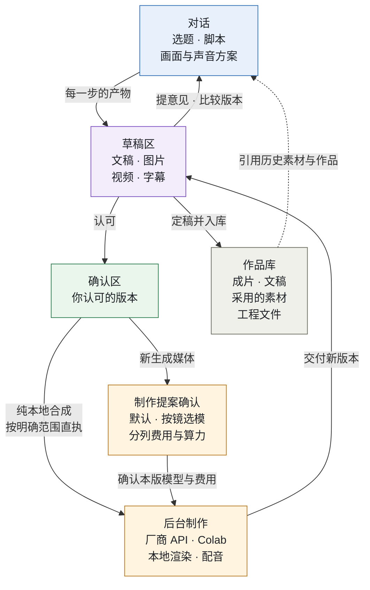

以仍为当前稿的同类产物为基准，再次本地制作会在同一事项中接续版本。旧稿、认可和定稿记录仍可查看。作品库标明素材的实际来源版本，带回历史素材时会引用那一版。代码工程的已知输入文件过大时，会在开工前提示换用较小文件。

三条规则贯穿全程：

- **先看稿，后制作。** 每一步的产物先进草稿区，只有你认可的版本进入确认区。认可只是保留，可以暂不制作。
- **生成新媒体逐次确认。** 纯本地剪辑按你明确提出的范围执行；新生成图片、视频或配音（含免费配音）先展示具体默认或已选连接、型号、音色与分列费用，确认后才发起外部调用。
- **制作冻结输入与绑定。** 受理时固定输入版本、连接与型号修订，之后改默认、继续聊天都不会改写这一次任务。

## 界面一览

截图来自本机隔离演示环境：画面使用仓库内置样片与合成演示配置，不含真实密钥或外部付费调用。

**作品总览。** 同一段对话里的几件作品按行对齐未确认与已确认，输入框底部常驻当前配置的默认模型摘要，点「审阅」逐项看稿。

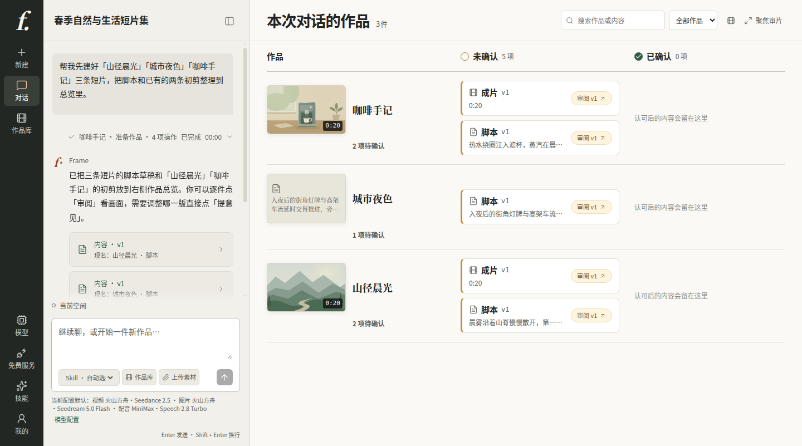

**媒体模型池配置。** 文本保持单个当前型号；图片、视频、配音可同时启用多个厂商连接与 Google Colab（`LTX-2.5`）进入模型池，每类可设一个默认或取消默认。


**制作前确认与按镜换模。** 提案卡常显本次涉及的连接、型号、音色与分列费用；既可一键沿用默认，也可整批调整或只把单个镜头切换为 Google Colab（`CU` 与人民币估价分开核算）。

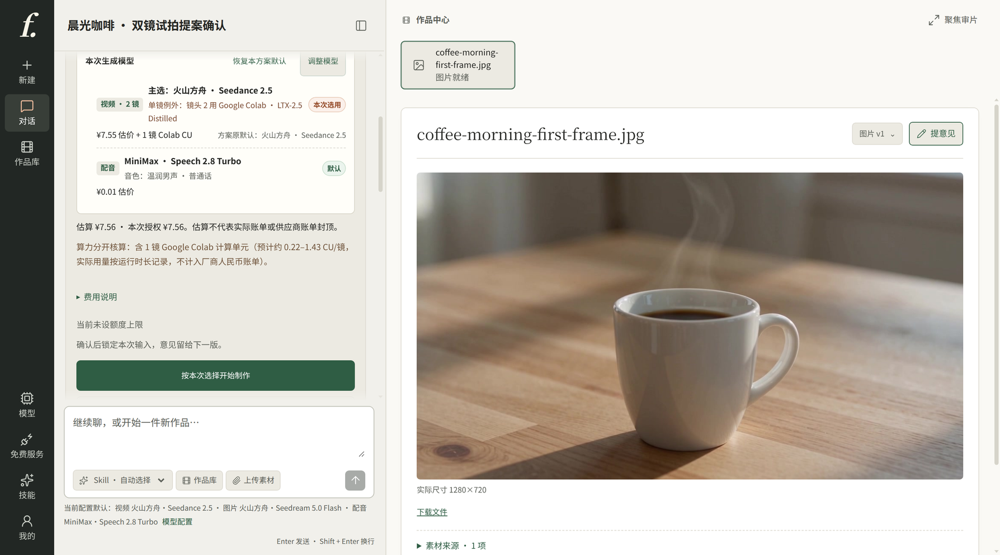

**审稿工作台。** 左侧继续对话，中间播放并比较成片版本，右侧常驻未确认与已确认双区。


**认可之后。** 这一版进入已确认并保留认可记录，可以接着审下一项，或以这一版定稿并入库。

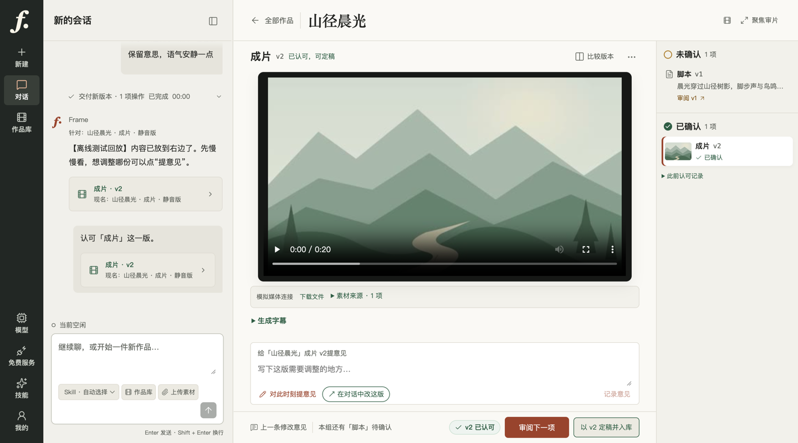

## 架构

工作台是一个 Node.js 服务：Fastify 负责 HTTP 与 SSE，SQLite 负责持久化，界面是 React 单页应用。对话由 Pi 运行时驱动，Frame 把业务能力做成工具交给它调用；授权、计费、制作和存储都在服务端，模型只能通过工具读取和提出。

### 系统总览

方框里是应用容器内的组件，框外是反向代理和它依赖的外部服务；虚线表示调用容器外的服务。

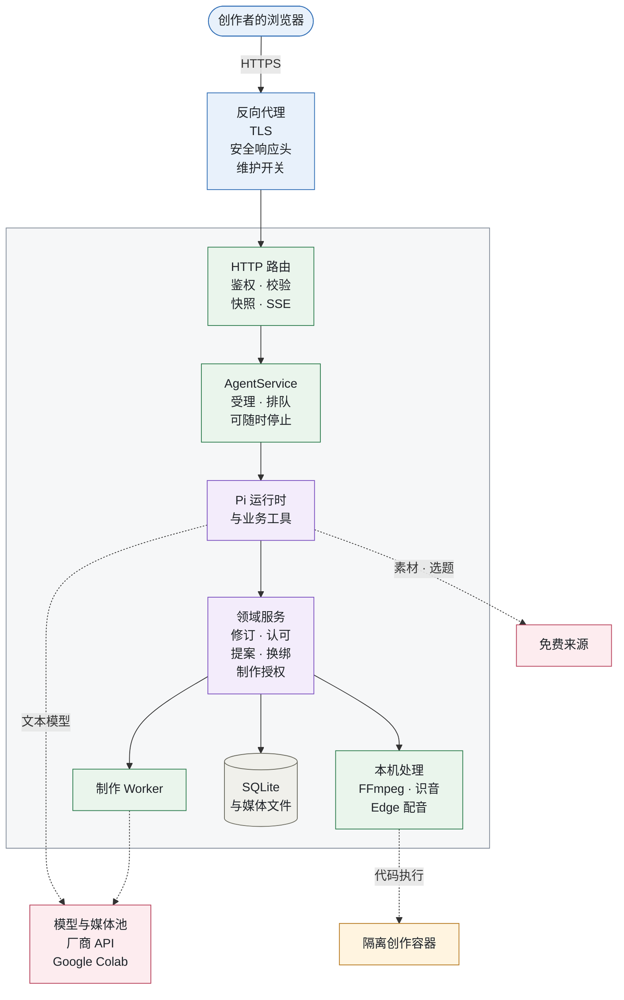

- **制作 Worker** 向供应商或云端算力通道发请求、轮询异步任务、记录费用与用量事实。模型与媒体通道目前有 OpenAI、火山方舟、MiniMax、通义万相，视频还可选接 Google Colab（`Lightricks/LTX-2.5-distilled`，按 Colab `CU` 单独核算）。
- **本机处理** 在应用容器里做 FFmpeg 渲染、字幕识别和受确认门保护的 Edge 免费配音。免费来源提供素材、音乐和选题：Pexels、Pixabay、Unsplash、Wikimedia Commons、Incompetech、NewsNow。
- **隔离创作容器** 承接 Skill 里的代码执行，见[代码执行隔离](#代码执行隔离)。

| 组件 | 职责 | 主要文件（`apps/studio/src/server/agent/`） |
| --- | --- | --- |
| HTTP 路由 | 鉴权、载荷校验、快照与 SSE | `routes.ts` |
| AgentService | 受理、排队、停止、命令回执 | `agent-service.ts`、`executor.ts` |
| Pi 运行时与工具 | 把业务能力交给模型调用 | `pi-runtime.ts`、`pi-tools.ts` |
| 领域服务 | 草稿修订、认可<br/>提案、换绑重算、授权、作品库 | `artifact-store.ts`、`creative-work.ts`、<br/>`production-service.ts` |
| 制作 Worker | 外部通道请求、异步轮询、费用事实 | `production-worker.ts`、`production-store.ts` |
| 媒体执行端口 | 图片、视频、配音各自的请求与解析 | `image-generation.ts`、`ark-media.ts`、<br/>`wan-video.ts`、`minimax-video.ts`、`colab-ltx-video.ts`、<br/>`minimax-speech.ts`、`openai-speech.ts`、`edge-speech.ts` |
| 本机处理 | FFmpeg 渲染、字幕识别 | `local-render.ts`、`subtitle-service.ts` |
| 免费服务与素材 | 免费配音、素材、音乐、选题 | `free-service-settings.ts`、`stock-providers.ts` |
| 隔离执行 | 经 Unix 域套接字调用创作宿主 | `creative-runner.ts` |
| 数据库 | 表结构与迁移 | `db.ts` |

### 一次对话的生命周期

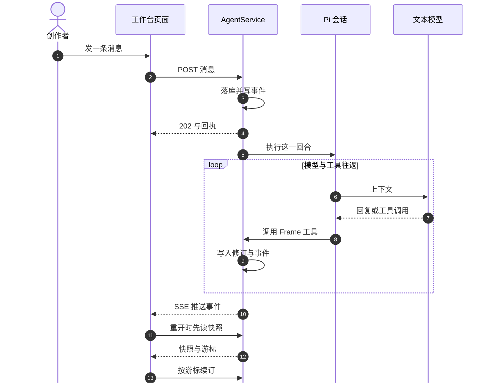

发消息立刻拿到 202 和一张回执，这一回合在后台按会话顺序执行。结果通过 SSE 推给页面：

- **写命令可重放。** 创建会话、发消息、停请求、受理提案、取消制作这些写命令都带 `commandId`：重复提交返回同一张回执。基于旧修订号的操作返回 `STALE_REVISION`（409）。
- **事件不丢不重。** 每次状态变化都在同一个事务里写一条事件（`message.changed`、`artifact.delivered`、`proposal.changed`、`run.changed`、`conversation.changed`）。页面重开先读快照，再从游标续订。
- **随时可停。** 进行中的请求可以停；排队或运行中的制作可以取消，运行进入 `cancel_requested`，由 Worker 收尾。

### 从认可到成片

新生成媒体的制作从一份提案开始。提案把范围、操作绑定与估价固定在一次修订上：在设置里切换或清空全局默认只影响后续新提案，池内连接仍启用时已有 `ready` 提案保持有效；输入修订变化、所用连接停用或更换密钥，或提案过期时，提案才作废。在提案卡内临时换型或改音色会由服务端确定性重算报价并生成新摘要，无需再次调用文本模型。你确认最新版本后，提案被受理为一次运行并冻结输入与四字段绑定；Worker 把运行拆成操作，逐个向对应通道发起尝试。

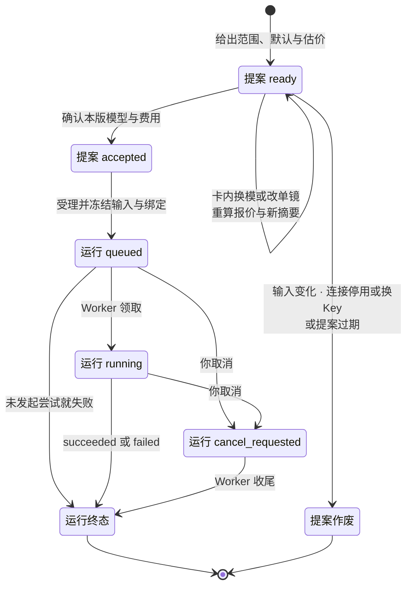

提案作废对应 `stale` 和 `expired` 两种状态；运行的终态是 `succeeded`、`failed` 或 `cancelled`。运行还有一个 `unknown` 状态：供应商的结果暂时核实不了，Worker 查清后再回到 `running` 或进入终态。

费用与算力按通道如实区分。厂商 API 金额以人民币核算，只认两种事实：权威事实带外部账单的逐笔明细，是最终金额；未核实事实来自供应商随结果上报的用量，在账单到达前继续占用额度。账单只给到汇总、对不上具体尝试时，界面继续显示「待对账」。Google Colab 视频通道消耗账户计算单元（`CU`），与厂商人民币账单分列披露；真实发起过 GPU 分配或运行的尝试记录 `CU` 用量与卡型证据并保持待核对状态，不伪造人民币零元账单；仅在分配前可证明未提交（如缺凭据或参数拒绝）或使用免外部调用的免费配音时，当场记为零元结算。

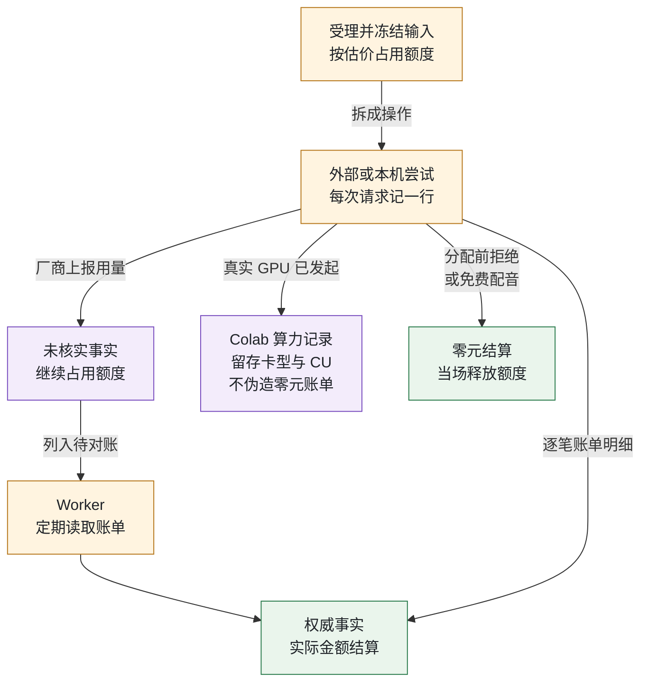

额度以人民币分保存，每次受理同时核对会话、自然日、自然月三个上限，未结算的款项跨期继续占用。管理员在「我的 → 成员与预算」管理成员和额度。

### 代码执行隔离

Skill 里的代码（自定义渲染、素材处理）不在应用容器里跑。应用容器拿不到 Docker socket，只能通过一个 Unix 域套接字调用宿主机上的创作宿主，宿主只认一组固定的动作。

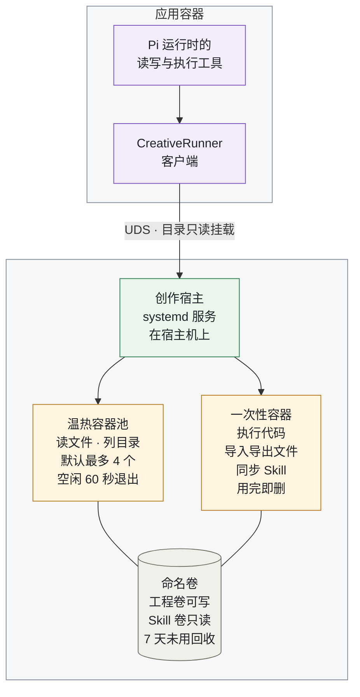

读写文件、列目录这类操作复用一组温热容器；执行代码、导入导出文件、同步 Skill 每次新建一个容器，结束即删。

运行代码与读写文件的容器用同一套限制：禁网、只读根文件系统、丢弃全部 capability、禁止提权、以创作宿主的服务账号身份运行、内存 1 GB、2 核、128 个进程、`/tmp` 256 MB。容器里没有模型 Key、应用数据和 Docker socket，只能看到当前工程的卷。

### 数据模型

核心链路：会话里的作品和草稿各自带修订；提案把认可的内容变成一次运行；运行拆成操作与尝试，费用事实挂在尝试上。下面两张图只画外键关系，表按分组列在图后，完整表结构在 `apps/studio/src/server/agent/db.ts`。

内容与提案：

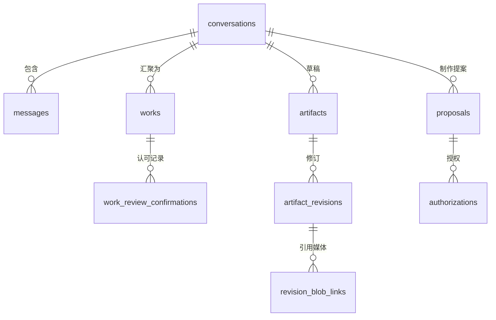

制作与费用：

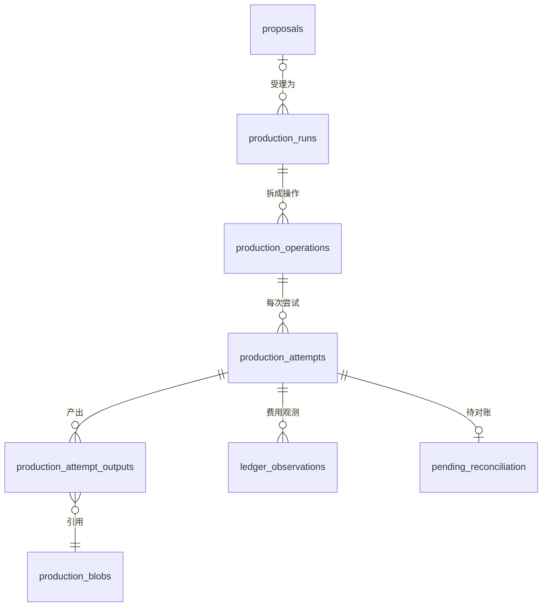

| 分组 | 表 |
| --- | --- |
| 对话与命令 | `conversations`、`messages`、`requests`、`request_deliveries`、<br/>`events`、`command_receipts`、`tool_invocations` |
| 作品与草稿 | `works`、`artifacts`、`artifact_revisions`、<br/>`revision_blob_links`、`work_review_confirmations`、`work_stage_confirmations` |
| 提案与授权 | `proposals`、`authorizations`、`user_actions` |
| 制作 | `production_runs`、`production_operations`、`production_attempts`、<br/>`production_attempt_outputs`、`production_input_locks`、`production_snapshots` |
| 媒体与素材 | `production_blobs`、`material_candidates`、`material_blob_sources`、<br/>`material_search_batches`、`library_input_preparations` |
| 账单与额度 | `ledger_observations`、`pending_reconciliation`、`budget_policies` |
| 模型与服务设置 | `provider_connections`、`provider_connection_settings`、`text_model_settings`、<br/>`text_model_entries`、`text_model_versions`、`free_service_settings`、<br/>`additional_media_settings`、`additional_media_versions`、`ark_video_settings`、<br/>`ark_video_configuration_versions`、`credential_encryption_state` |
| 账号与运维 | `studio_users`、`studio_account_settings`、`user_profiles`、<br/>`storage_cleanups`、`agent_schema_migrations` |

### 仓库结构

| 目录 | 内容 |
| --- | --- |
| `apps/studio/src/server` | 服务端；`agent/` 下是路由、领域服务、供应商端口、Worker 与数据库 |
| `apps/studio/src/client` | React 工作台 |
| `apps/studio/src/shared` | 由契约生成的类型与校验代码 |
| `apps/studio/test` | 服务端与界面测试；全部使用替身，不需要真实凭据 |
| `contracts/agent/v1` | HTTP、事件流与工具契约：OpenAPI、JSON Schema、样例和离线校验 |
| `docker/` | 基础镜像、应用镜像、创作镜像、生产 Compose、创作宿主的 systemd 单元 |
| `deploy/` | Nginx 站点模板、安全响应头、出口路由相关配置 |
| `scripts/` | 发布脚本与预演、创作宿主、备份与凭据轮换、出口路由刷新、离线识别安装 |
| `perf/bench` | 首屏与发送性能的采样和棘轮 |
| `docs/` | 架构、产品设计、部署手册、执行进度 |
| `examples/briefs` | 示例创作简报 |

## 本地运行

需要 **Node.js 22.23.1**（或兼容的 22 LTS）、npm；媒体处理使用 `ffmpeg` 和 `ffprobe`。首次安装原生依赖时可能需要 Python 3 与 C++ 构建工具。

```sh
npm ci
npm run studio:build
STUDIO_DEV=1 STUDIO_HOST=127.0.0.1 STUDIO_PORT=4478 npm run studio:start
```

浏览器打开 [本机工作台](http://127.0.0.1:4478/agent)。首次在「模型配置」填写你自己的连接，为文本选择「当前使用」型号，为图片、视频、配音启用模型池并按需设置默认值。可在「免费服务」启用免费配音、素材、音乐和选题来源，在「Skill 管理」查看内置的 `video-generation`、`colab-ltx-video`、`travel-prompt-kit` 或安装扩展。聊天需要已配置的文本模型；新生成媒体需要池内可用型号并经提案确认。空数据库不会带入任何人的密钥、会话或素材。

### 媒体模型池、默认值与制作前确认

1. **在「模型配置」管理模型池与默认值**
   - **文本模型**：保留单个「当前使用」型号，对话回合直接调用。
   - **图片 / 视频 / 配音模型池**：同一类别可同时启用多个连接与型号进入池中（同型号多账号按连接名称独立区分，不互相覆盖）。每类至多设一个**默认模型**（新提案自动预填），也可点击「取消默认」留空（新提案进入待选态，选定后方可开始）。
   - **配音池与免费配音三态互通**：在「免费服务」开启 `Edge 免费配音` 后，它会与已启用的 OpenAI / MiniMax 付费语音并列出现在配音池中，可在「付费默认 ↔ Edge 免费默认 ↔ 无默认」之间直接切换。
   - **接入可选的 Google Colab（`LTX-2.5`）视频通道**：在「模型配置 → 连接配置」新建协议为 `Google Colab (LTX-2.5)` 的连接并勾选启用 `Lightricks/LTX-2.5-distilled`（当前已适配规格：**单张冻结首帧图 + 动作提示词、`720p`、固定 `5` 秒、`16:9` 或 `9:16`、`native` 或 `none` 音频**；同一提案内多个 Colab 镜头自动驻留内存热复用，末镜完成或取消时释放实例）。API Key 可填写已同意 [`Lightricks/LTX-2.5`](https://huggingface.co/Lightricks/LTX-2.5) 门控协议的 Hugging Face Read Token（`hf_...`，服务端静态加密保存），或在运行环境已存有宿主凭据时填非敏感占位值 `host`。实际执行需运行环境安装官方 [`google-colab-cli`](https://github.com/googlecolab/google-colab-cli)（`colab`，可通过 `COLAB_CLI_BIN` 指定路径）并完成一次 Google Colab OAuth 授权（可运行 `python3 scripts/ultra_config.py setup` 按提示用浏览器完成远程授权）；未安装或未授权时，厂商 API 与免费配音不受影响，选中 Colab 会在申请 GPU 前以 `¥0.00` 明确返回缺失原因。

2. **在对话与制作确认卡选择厂商或具体 Colab 模型**
   - **提前查看与对话点名**：对话输入框底部常驻只读「当前配置默认」摘要；你在消息中明确点名连接名、厂商或选用 `colab-ltx-video` 技能时，提案会优先绑定对应通道（若该通道未启用或缺少单张首帧等必要条件，Agent 会如实说明并列出池内可用项，绝不暗自替换成其他厂商）。
   - **一键沿用默认**：收到制作提案卡后，首屏无展开下拉框，直接展示本次涉及类别的 `连接名 · 型号名`、`默认` 标识、配音音色以及分开核算的费用（厂商人民币估价、Google Colab `CU` 或 `¥0.00` 免费配音），核对无误点一次「**使用默认模型并开始制作**」即可启动。
   - **按类或单镜临时换型**：点击「**调整模型**」可整批切换某类别的连接/型号或配音音色；展开「**查看制作范围**」可针对单个镜头独立改用具体 Colab 连接或其他厂商（不满足该镜参数边界的型号会置灰注明原因，收起后仍常显单镜例外与「方案原默认」）。每次调整由服务端确定性重算报价并刷新按钮为「**按本次选择开始制作**」，也可随时点「**恢复本方案默认**」。

3. **线上服务器（Docker 容器）使用前需要的配置**
   - **常规厂商 API 与免费配音**：线上部署就绪后无需改动宿主机环境，直接登录网页在「模型配置」添加连接、启用池内型号并设置默认值即可（连接密钥由服务器 `$PROJECT_PATH/.env.docker.prod` 中的 `FRAME_CREDENTIAL_SECRET` 加密保存在持久卷 `/data/factory/agent`）；在「免费服务」开启 `Edge 免费配音` 即可直接使用镜像内置的 `/opt/frame-tts`。
   - **线上启用 Google Colab（`LTX-2.5`）视频通道**：生产镜像 `video-factory` 已内置独立 Python 3.12 环境下的官方 `google-colab-cli`（固定提交 `5cafdfaef456cfc7b3e218638c506df8f7088997`，位于 `/opt/frame-colab/venv/bin/colab`，已加入 `PATH` 且 `COLAB_CLI_BIN` 默认指向该路径，无需手工安装 CLI）、`ColabLtxVideoPort` 适配器、`.agents/skills/colab-ltx-video/scripts/{colab_ltx.py,ltx25_remote_worker.py}` 及 `scripts/{ultra_media_common.py,ultra_config.py}`；模型权重仍在云端 Colab GPU 侧拉取。线上首次使用前仅需完成本人的账号授权：
     1. 确认服务器境外出口可达 `colab.research.google.com`、`*.googleapis.com` 与 `huggingface.co`，在应用容器中将一次 Google OAuth 刷新令牌写入持久数据卷 `/data/factory`（滚动发布自动保留）：
        ```sh
        docker exec video_factory_prod python3 scripts/ultra_config.py google-auth-url
        # 在本机浏览器打开输出的 URL 完成 Google 账号授权，再按隐藏输入提示写回容器持久卷：
        docker exec -it video_factory_prod python3 scripts/ultra_config.py google-auth-code
        ```
     2. 登录网页「模型配置 → 连接配置」新建 `Google Colab (LTX-2.5)` 连接并勾选启用 `Lightricks/LTX-2.5-distilled`，API Key 填入已同意门控协议的 Hugging Face Read Token（`hf_...`，服务端加密存储；也可经 `docker exec -i video_factory_prod python3 scripts/ultra_config.py set-hf --stdin` 写入持久卷后在网页填 `host`）。未完成账号授权前，线上厂商 API 与免费配音完全不受影响，仅在选中 Colab 时于申请 GPU 前以 `¥0.00` 明确提示未授权。

想看最近适合拍什么，在「免费服务 → 视频选题」配置国内平台榜单：填入可访问的 NewsNow 地址，选用抖音、快手和 B 站预设并保存。想在本机运行榜单服务时，先启动 Docker，再运行 `make setup-local-trends`，宿主机上的 Frame 可以使用 `http://127.0.0.1:4444`（本机地址属私网边界，需要 `STUDIO_DEV=1` 或 `NEWSNOW_ALLOW_PRIVATE_NETWORK=1` 显式放行）。然后可以在聊天里问：“看下抖音和 B 站，给我三个能在家拍的选题，附上参考视频或话题链接。”只聊选题不会开始制作。

默认数据目录是 `workspace/factory/agent/`。设置 `AGENT_DATA_DIR` 可将数据库、Pi 会话和媒体放在其他持久目录。开发模式仅在本机使用；服务器部署使用登录和 HTTPS。

服务端可用的相关环境变量：

- `AGENT_EDGE_TTS_PYTHON`：免费配音（edge-tts 维护版客户端）的 Python 解释器命令，默认 `python3`；容器镜像内已指向专用虚拟环境。命令只来自服务端环境，设置页不再提供可写的解释器入口。
- `COLAB_CLI_BIN` / `COLAB_CLI_AUTH`：可选；生产容器镜像已内置 `/opt/frame-colab/venv/bin/colab` 并默认配置，本机裸跑时可用于指定其他路径的 `google-colab-cli` 可执行文件或认证模式（如 `oauth2`、`adc`）。
- `NEWSNOW_ALLOW_PRIVATE_NETWORK=1`：允许 NewsNow 地址指向环回、内网或链路本地段（保存与请求前都会校验，含云元数据地址）。仅本机联调使用。
- `STUDIO_DEV=1`：开发模式，同样放行上述私网地址，并启用本地开发用的入口行为。
- `STUDIO_TRUST_PROXY`：受信任的反向代理地址（IP 或 CIDR，逗号分隔），决定是否采信 `X-Forwarded-For` 以取真实客户端 IP（登录限流按它计数）。默认 `127.0.0.1`，适配裸机/systemd 直反代；Docker Compose 发布端口时容器内对端是网桥网关，生产编排已默认放行 `172.16.0.0/12`。

## 发布与部署

### 发布流水线

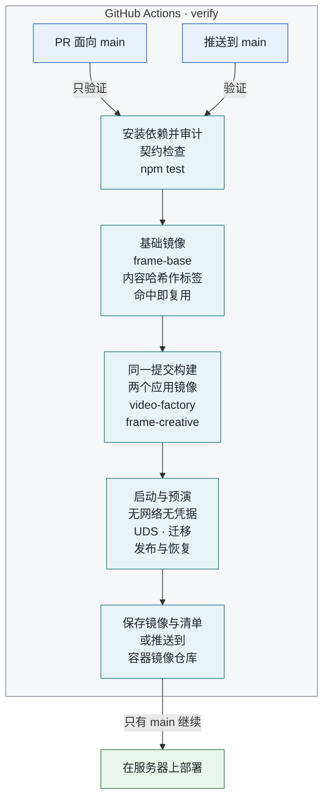

面向 `main` 的 PR 只跑验证；[推送或合入 `main`](.github/workflows/ci-cd.yml) 后，Actions 对最终提交再验证一次并部署到阿里云 ECS。镜像和部署清单都对应同一个提交，服务器上不重新安装依赖或构建。配置镜像仓库的四个 secret 后按层传输，否则随运行保存镜像归档再传到服务器。

### 服务器拓扑

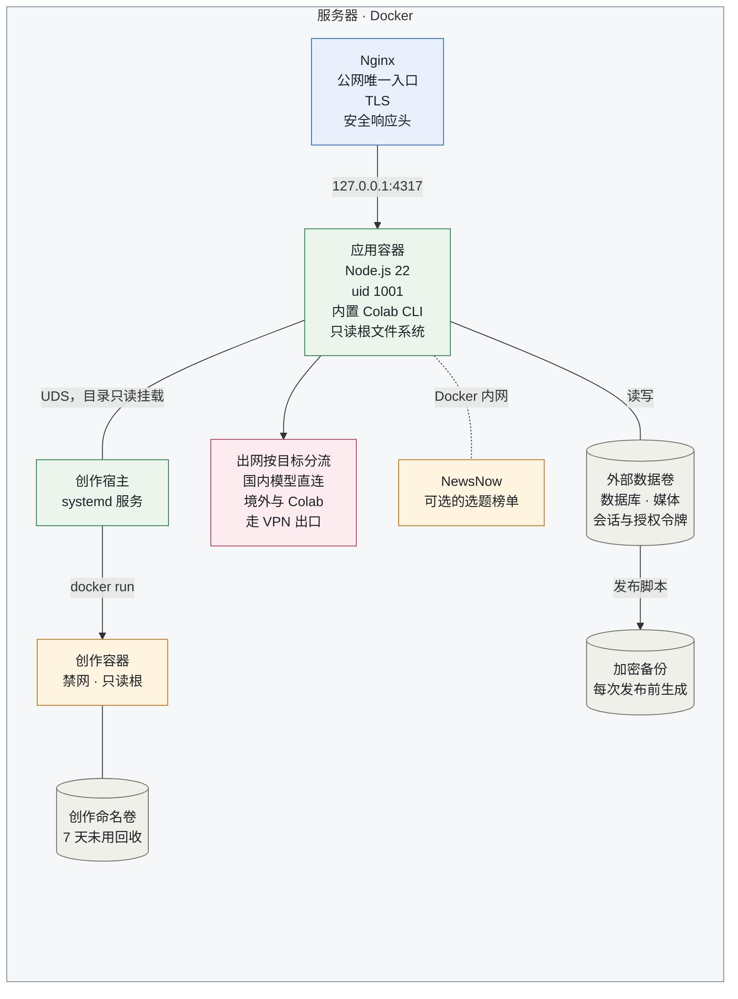

对外只暴露反向代理，应用端口只绑定在回环地址，以非 root 运行、根文件系统只读。数据都在一个外部卷里，每次发布前先做加密备份。出网按真实目标分流：国内的模型与存储直连，境外服务走服务器的 VPN 出口。`GET /api/health` 返回 `release` 字段，可以核对线上是哪个提交。

### 切换、备份与恢复

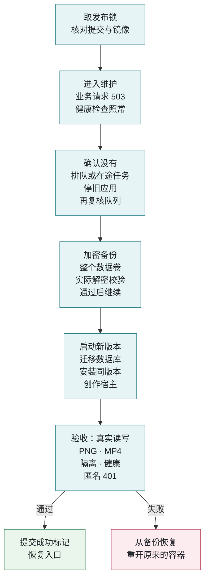

发布脚本先隔离入口，再动数据。验收从正在运行的新版本里发起：用编译好的客户端经真实 socket 调用创作宿主，核对镜像 ID、运行身份、数据库版本，以及本地和公开的健康检查。活动中的任务不会被部署脚本取消：入口进入维护后，只要查到排队或在途的请求与制作，这次发布就中止并恢复入口。

备份默认用 OpenSSL CMS AES-256-GCM，也可以改用 age；恢复身份需要离线保管。回退到更早的版本要先另作一次备份，再选定数据时间点：数据库迁移不能只靠重启旧代码撤销。

```sh
curl -fsS https://video.example.com/api/health
docker ps --filter name=video_factory_prod
```

生产配置、凭据、备份和回滚方法见[部署手册](docs/guides/deployment.md)。

## 文档与验证

| 我想了解 | 入口 |
| --- | --- |
| 对话、草稿、确认与作品库如何配合 | [产品与交互设计](docs/agent/product-design.md) · [界面规范](DESIGN.md) |
| Pi 与业务服务的职责、存储和制作流程 | [架构设计](docs/agent/architecture.md) |
| HTTP、事件流、类型和工具边界 | [接口索引](contracts/agent/v1/IMPORT.md) · [OpenAPI](contracts/agent/v1/openapi.json) · [JSON Schema](contracts/agent/v1/contracts.schema.json) |
| GitHub Actions、生产配置、备份与回滚 | [部署手册](docs/guides/deployment.md) |
| 历次修复的取舍与门禁结果 | [执行进度](docs/agent/audit-execution-progress.md) |
| 查询已退役的 Video Factory 架构 | [历史架构存档](https://github.com/yaoziyaoguai/video-factory/tree/74a4580eff12e3a62ad78f8613cfb8efa0f4ee83/docs/过期文档) |

`npm run contracts:check` 离线检查接口、样例与生成类型。`npm test` 运行仓库测试；只验工作台可在构建后运行 `npm run test:agent --workspace @video-factory/studio`。这些测试不需要真实模型凭据。

构建后运行 `npm run perf:frame`。同一台环回离线服务交替提供原始和 Brotli 静态资源，浏览器每次使用独立上下文并记录实际响应编码。首屏采样 10 对，发送采样 40 对。原始数据和两侧的截图在 `perf/.local/`。使用现有 Playwright 环境时，通过 `PLAYWRIGHT_MODULE_PATH` 指定模块目录，通过 `PLAYWRIGHT_EXECUTABLE_PATH` 指定 Chrome 或 Chromium 可执行文件。
