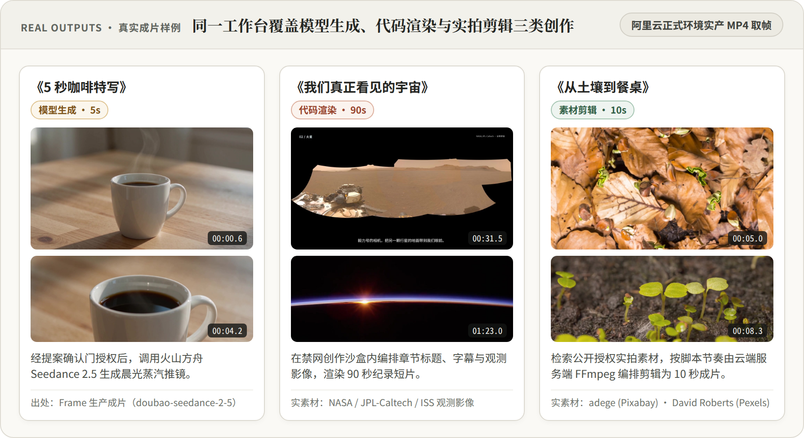
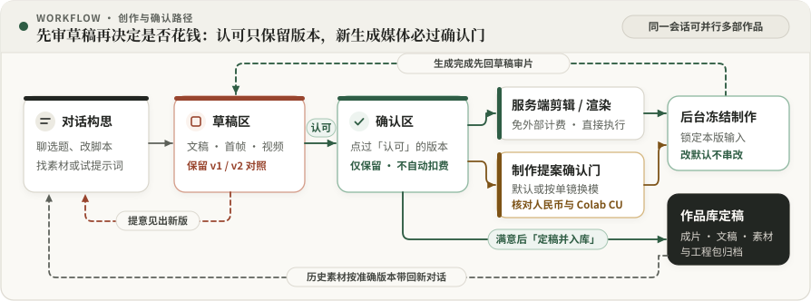
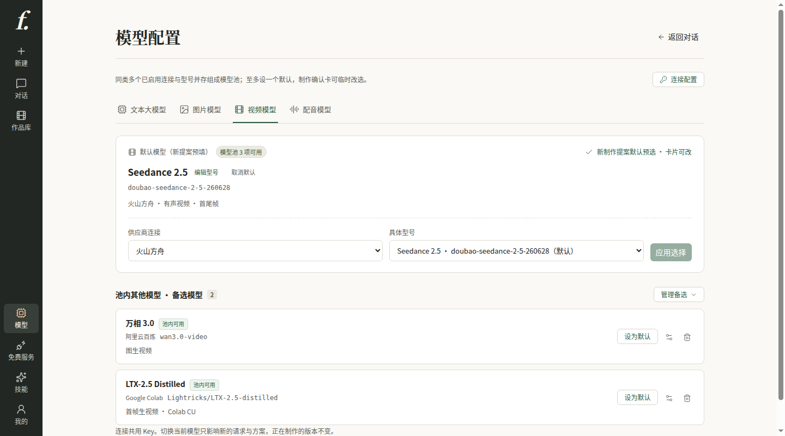
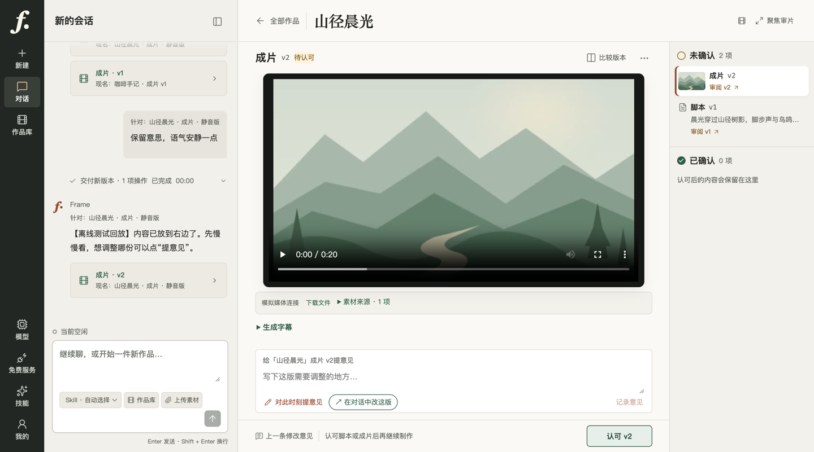
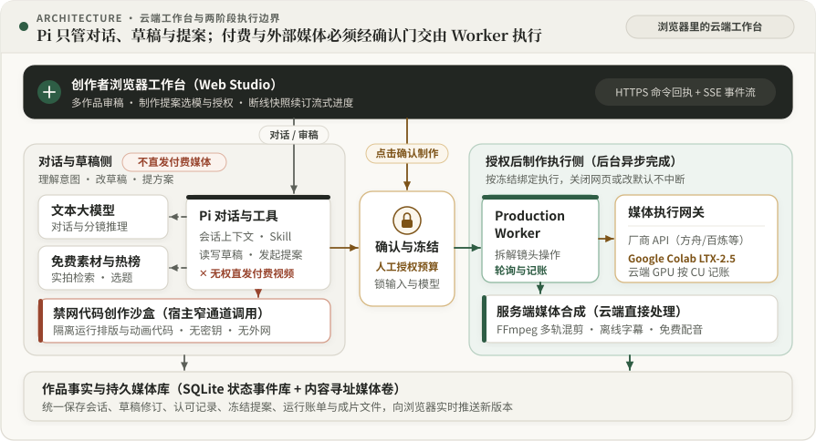
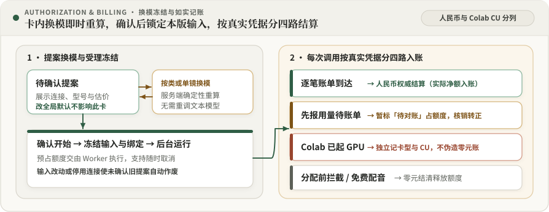
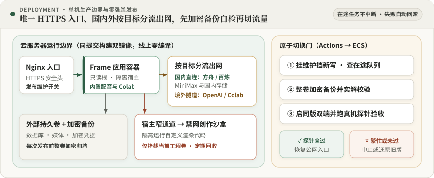

# 帧间 Frame · Video Agent


帧间（Frame）是一个在浏览器里使用的云端视频创作工作台（也可在本机或自有服务器自托管）。你可以先聊选题、改脚本、找素材，在同一段对话里并行推进几条不同题材的视频；明确开始创作后，Frame 把模型生成镜头、代码排版渲染与实拍素材剪辑放进同一套审阅与费用门禁里完成交付。

Node.js 22 · TypeScript · Fastify · SQLite · React · Pi · FFmpeg · Docker

> 封面右栏取自阿里云正式环境三支真实成片：《我们真正看见的宇宙》（90 秒太空纪录短片，62 秒处取帧，影像署名 [NASA、ESA、CSA、STScI · Webb 船底座星云](https://science.nasa.gov/asset/webb/cosmic-cliffs-in-the-carina-nebula-nircam-image/)）、《5 秒咖啡特写》（火山方舟 `doubao-seedance-2-5-260628` 生成镜头，2.35 秒处取帧）、《从土壤到餐桌》（10 秒实拍剪辑短片，8.3 秒处取帧，素材署名 [David Roberts / Pexels](https://www.pexels.com/video/time-lapse-of-seedlings-8522207/)）。

## 目录

- [它能做什么](#它能做什么)
- [界面一览](#界面一览)
- [架构](#架构)：[系统总览](#系统总览) · [一次对话的生命周期](#一次对话的生命周期) · [从认可到成片](#从认可到成片) · [代码执行隔离](#代码执行隔离) · [数据模型](#数据模型) · [仓库结构](#仓库结构)
- [自托管与本地运行](#自托管与本地运行)：[媒体模型池、默认值与制作前确认](#媒体模型池默认值与制作前确认)
- [发布与部署](#发布与部署)：[生产拓扑与原子切换](#生产拓扑与原子切换) · [备份与恢复](#备份与恢复)
- [文档与验证](#文档与验证)

## 它能做什么



*上图成片及第三方素材出处：《5 秒咖啡特写》（0.6 秒与 4.15 秒取帧，Frame 经火山方舟 `Seedance 2.5` 生成）；《我们真正看见的宇宙》（31.5 秒与 83 秒取帧，Frame 渲染章节标题与字幕，观测素材署名 [NASA/JPL-Caltech PIA25406](https://images.nasa.gov/details/PIA25406) 及 [NASA ISS 4K Crew Earth Observations / Wikimedia Commons](https://commons.wikimedia.org/wiki/File:ISS_4K_Crew_Earth_Observations.webm)）；《从土壤到餐桌》（5 秒与 8.3 秒取帧，Frame 服务端编排剪辑，实拍素材署名 [adege / Pixabay](https://pixabay.com/videos/id-22983/) 及 [David Roberts / Pexels](https://www.pexels.com/video/time-lapse-of-seedlings-8522207/)）。*

1. **对话与多版本草稿。** 给出目标，和 Agent 讨论内容。每一步产出的脚本、画面与声音方案、首帧、片段或成片都先进入草稿区，保留 `v1 / v2` 修订供对比和提意见。
2. **分项认可，不自动扣费。** 只有你点过「认可」的具体版本进入确认区；认可只是保留成果，可以暂不制作，后续改稿也不会覆盖这一版。
3. **服务端直执与外部调用分流。** 免外部模型计费的服务端剪辑与隔离代码渲染（均在云端 Frame 服务端执行 FFmpeg 与渲染环境，无需打开个人电脑上的剪辑软件）按你明确提出的范围直接执行；凡涉及新生成图片、视频或配音（含免费配音），先在制作提案卡里展示具体连接、型号、音色与分列费用（厂商人民币估价、Google Colab `CU` 或 `¥0.00` 免费配音），你可一键沿用默认，也可在卡内整批或逐镜切换型号后再授权执行。
4. **冻结运行与定稿入库。** 受理时锁定本版输入与模型连接修订，继续聊天或改默认都不会改写这次任务。生成的视频先回到草稿区供审片，满意后明确「定稿并入库」，成片、对应文稿、实际采用的素材版本与制作工程包一起归档，随时可带回新对话复用。



以仍为当前稿的同类产物为基准，再次由服务端合成会在同一事项中接续版本。旧稿、认可和定稿记录仍可查看。代码工程的已知输入文件过大时，会在开工前提示换用较小文件。

## 界面一览

以下工作台界面截自隔离演示环境：载入上述三支真实成片帧与合成模型池配置以演示多作品审阅、按镜换模和认可定稿交互；界面内的认可、试拍提案与选模状态仅为交互演示，不代表线上生产记录，也未发起真实外部扣费或 Colab 调用。

**作品总览。** 同一段对话里的多支作品按行对齐「未确认」与「已确认」，输入框底部常驻当前配置的默认模型摘要，点「审阅」逐项看稿。


**媒体模型池配置。** 文本保持单个当前型号；图片、视频、配音可同时启用多个厂商连接与 Google Colab（`LTX-2.5`）进入模型池，每类至多设一个默认或取消默认。



**制作前确认与按镜换模（界面演示）。** 提案卡常显本次涉及的连接、型号、音色与分列费用；以真实初帧发起多镜试拍提案时，既可一键沿用默认，也可只将单个镜头切换为池内的 Google Colab `LTX-2.5`（`CU` 与人民币估价分开核算）。


**审片与定稿工作台。** 左侧继续对话，中间按时间码播放并审阅成片版本，右侧常驻未确认与已确认双区；认可后可直接审阅下一项，或以当前认可版本定稿并入库。



## 架构

Frame 服务端是一个 Node.js 应用：Fastify 负责 HTTP 与 SSE，SQLite 与内容寻址文件卷负责持久化，前端是在浏览器里运行的 React 单页工作台。对话由 Pi 运行时驱动，Frame 把受控业务能力做成工具交给它调用；**Pi 只能读写草稿与发起待确认提案，无权直接触发付费媒体生成**——真正的授权核验、额度占用、外部媒体调用与文件落盘全部在服务端确认门之后由 `ProductionWorker` 完成。

### 系统总览



- **对话与草稿侧**：承接聊天推理、免费实拍与热点检索（Pexels、Pixabay、Unsplash、Wikimedia Commons、Incompetech、NewsNow），并通过宿主机窄接口调用禁网创作沙盒运行自定义渲染代码。
- **确认与冻结门**：校验用户明确授权，在同一数据库事务内锁定输入修订、四字段 `ModelBinding` 与预算占用。
- **授权后制作执行侧**：`ProductionWorker` 独立轮询并拆解镜头操作，经媒体执行网关调用厂商 API（OpenAI、火山方舟、阿里云百炼、MiniMax）或 Google Colab（`Lightricks/LTX-2.5-distilled`，按 `CU` 独立记账），以及在云端应用容器内执行服务端媒体合成（FFmpeg 混剪、离线语音转字幕、受确认门保护的 Edge 免费配音）。即使关闭浏览器页面，后台制作仍会完整跑完并交付新草稿。

| 组件 | 职责 | 主要文件（`apps/studio/src/server/agent/`） |
| --- | --- | --- |
| HTTP 路由 | 鉴权、载荷校验、快照与 SSE | `routes.ts` |
| AgentService | 受理、会话串行排队、随时停止、命令回执 | `agent-service.ts`、`executor.ts` |
| Pi 运行时与工具 | 上下文管理、Skill 加载、把业务能力交给模型调用 | `pi-runtime.ts`、`pi-tools.ts` |
| 领域与授权服务 | 草稿修订、认可、提案、确定性换绑重算、授权冻结、作品库 | `artifact-store.ts`、`creative-work.ts`、`production-service.ts` |
| ProductionWorker | 外部通道请求、异步轮询、账单与算力事实登记 | `production-worker.ts`、`production-store.ts` |
| 媒体执行网关 | 图片、视频、配音各自的请求与回执解析 | `image-generation.ts`、`ark-media.ts`、`wan-video.ts`、`minimax-video.ts`、`colab-ltx-video.ts`、`minimax-speech.ts`、`openai-speech.ts`、`edge-speech.ts` |
| 服务端媒体合成 | 云端容器内 FFmpeg 渲染、离线字幕识别 | `local-render.ts`、`subtitle-service.ts` |
| 免费服务与素材 | 免费配音设置、公开授权素材、音乐与选题检索 | `free-service-settings.ts`、`stock-providers.ts` |
| 隔离执行客户端 | 经 Unix 域套接字调用宿主机创作宿主 | `creative-runner.ts` |
| 数据库 | 表结构与迁移 | `db.ts` |

### 一次对话的生命周期

浏览器发出消息后立即收到 `202` 与命令回执，回合在服务端按会话顺序串行执行，进度与产物通过 SSE 实时推回页面：

- **写命令可重放。** 创建会话、发消息、停止请求、换绑提案、受理制作、取消运行均携带幂等 `commandId`，重复提交返回同一张回执；基于过期修订号的操作返回 `409 STALE_REVISION`。
- **事件不丢不重。** 每次状态写入在同一事务内追加一条有序事件（`message.changed`、`artifact.delivered`、`proposal.changed`、`run.changed`、`conversation.changed`）。页面重连先读完整快照，再按游标续订增量流。
- **随时可停。** 进行中的模型回合可随时中断；排队或运行中的制作任务可随时发起取消，进入 `cancel_requested` 由 Worker 安全收尾。

### 从认可到成片

新生成媒体的制作从一份 `ready` 提案开始。设置页切换或清空全局默认只影响后续新提案，只要池内所用连接仍启用，已生成的待确认提案保持有效；仅当输入修订变化、所用连接停用或更换密钥，或提案超时，旧提案才转为 `stale / expired` 作废。在提案卡内整批或按单镜切换型号、调整音色时，服务端通过 `/rebind` 确定性重算报价并刷新摘要，无需重新唤醒文本大模型。



确认开始后，运行拆成具体操作与逐次尝试（`Attempt`）；当供应商状态暂不可知时记为 `unknown` 留存原尝试，查明后再恢复或进入终态（`succeeded`、`failed`、`cancelled`），不把超时当作免费重发依据。费用与异构算力按真实凭据分四路结算：

- **人民币权威结算**：逐笔外部账单明细匹配冻结连接与任务号，按实际净额结算。
- **未核实暂占额度**：厂商随结果先报用量而逐笔账单未到（或仅有无法对应单笔任务的汇总账单）时，继续跨期占用人民币额度并标为「待对账」，Worker 轮询账单核销后转为权威结算。
- **Colab 算力独立留证**：已实际发起云端 GPU 分配或运行的尝试记录卡型与 `CU` 用量证据，与厂商人民币账单分列披露，绝不伪造零元人民币账单。
- **零元当场释放**：申请 GPU 前因缺凭据/参数被拦截，或采用免外部计费的 Edge 免费配音时，当场记零元结算并释放预占额度。

额度以人民币「分」保存，每次受理同时核对会话、自然日、自然月三个上限；管理员在「我的 → 成员与预算」管理团队成员与额度。

### 代码执行隔离

Skill 中的自定义排版、数据动画与素材处理代码不在主应用容器内运行。主应用容器以非特权身份（`uid 1001`、只读根文件系统）运行且拿不到 Docker socket，仅能经只读挂载的 Unix 域套接字（`/run/frame-creative/runner.sock`）向宿主机上的 `frame-creative` 守护服务发起受限动作：

- **温热容器池**（默认最多 4 个，空闲 60 秒回收）承接读文件、列目录等轻量操作；**一次性容器**承接代码执行、导入导出与 Skill 同步，用完即删。
- 所有创作容器统一启用硬隔离：**禁网（`--network none`）、只读根文件系统、丢弃全部 capability、禁止提权、1 GB 内存 / 2 核 / 128 进程上限**。容器内没有模型密钥、业务数据库与宿主控制接口，仅挂载当前工程命名卷（7 天未用自动回收）。

### 数据模型

核心外键链路：`conversations` 汇聚 `messages`、`works`（含 `work_review_confirmations`）与 `artifacts` → `artifact_revisions`（经 `revision_blob_links` 关联媒体）；`proposals` 经用户 `authorizations` 受理为 `production_runs` → `production_operations` → `production_attempts`，每次尝试关联产出 `production_blobs`、费用事实 `ledger_observations` 与待对账项 `pending_reconciliation`。完整定义见 `apps/studio/src/server/agent/db.ts`。

| 分组 | 表 |
| --- | --- |
| 对话与命令 | `conversations`、`messages`、`requests`、`request_deliveries`、`events`、`command_receipts`、`tool_invocations` |
| 作品与草稿 | `works`、`artifacts`、`artifact_revisions`、`revision_blob_links`、`work_review_confirmations`、`work_stage_confirmations` |
| 提案与授权 | `proposals`、`authorizations`、`user_actions` |
| 制作 | `production_runs`、`production_operations`、`production_attempts`、`production_attempt_outputs`、`production_input_locks`、`production_snapshots` |
| 媒体与素材 | `production_blobs`、`material_candidates`、`material_blob_sources`、`material_search_batches`、`library_input_preparations` |
| 账单与额度 | `ledger_observations`、`pending_reconciliation`、`budget_policies` |
| 模型与服务设置 | `provider_connections`、`provider_connection_settings`、`text_model_settings`、`text_model_entries`、`text_model_versions`、`free_service_settings`、`additional_media_settings`、`additional_media_versions`、`ark_video_settings`、`ark_video_configuration_versions`、`credential_encryption_state` |
| 账号与运维 | `studio_users`、`studio_account_settings`、`user_profiles`、`storage_cleanups`、`agent_schema_migrations` |

### 仓库结构

| 目录 | 内容 |
| --- | --- |
| `apps/studio/src/server` | 服务端；`agent/` 下是路由、领域服务、供应商端口、Worker 与数据库 |
| `apps/studio/src/client` | 浏览器端 React 工作台 |
| `apps/studio/src/shared` | 由契约生成的类型与校验代码 |
| `apps/studio/test` | 服务端与界面测试；全部使用替身，不需要真实凭据 |
| `contracts/agent/v1` | HTTP、事件流与工具契约：OpenAPI、JSON Schema、样例和离线校验 |
| `docker/` | 基础镜像、应用镜像、创作镜像、生产 Compose、创作宿主的 systemd 单元 |
| `deploy/` | Nginx 站点模板、安全响应头、出口路由相关配置 |
| `scripts/` | 发布脚本与预演、创作宿主、备份与凭据轮换、出口路由刷新、离线识别安装 |
| `perf/bench` | 首屏与发送性能的采样和棘轮 |
| `docs/` | 架构、产品设计、部署手册、执行进度 |
| `examples/briefs` | 示例创作简报 |

## 自托管与本地运行

日常使用只需通过浏览器访问已部署的云端工作台；如需在本机开发或自托管运行服务端，需要 **Node.js 22.23.1**（或兼容的 22 LTS）、npm，服务端媒体处理使用 `ffmpeg` 和 `ffprobe`。首次安装原生依赖时可能需要 Python 3 与 C++ 构建工具。

```sh
npm ci
npm run studio:build
STUDIO_DEV=1 STUDIO_HOST=127.0.0.1 STUDIO_PORT=4478 npm run studio:start
```

浏览器打开 [本机工作台](http://127.0.0.1:4478/agent)。首次在「模型配置」填写你自己的连接，为文本选择「当前使用」型号，为图片、视频、配音启用模型池并按需设置默认值。可在「免费服务」启用免费配音、素材、音乐和选题来源，在「Skill 管理」查看内置的 `video-generation`、`colab-ltx-video`、`travel-prompt-kit` 或安装扩展。聊天需要已配置的文本模型；新生成媒体需要池内可用型号并经提案确认。空数据库不会带入任何人的密钥、会话或素材。

### 媒体模型池、默认值与制作前确认

1. **在「模型配置」管理模型池与默认值**
   - **文本模型**：保留单个「当前使用」型号，对话回合直接调用。
   - **图片 / 视频 / 配音模型池**：同一类别可同时启用多个连接与型号进入池中（同型号多账号按连接名称独立区分，不互相覆盖）。每类至多设一个**默认模型**（新提案自动预填），也可点击「取消默认」留空（新提案进入待选态，选定后方可开始）。
   - **配音池与免费配音三态互通**：在「免费服务」开启 `Edge 免费配音` 后，它会与已启用的 OpenAI / MiniMax 付费语音并列出现在配音池中，可在「付费默认 ↔ Edge 免费默认 ↔ 无默认」之间直接切换。
   - **接入可选的 Google Colab（`LTX-2.5`）视频通道**：在「模型配置 → 连接配置」新建协议为 `Google Colab (LTX-2.5)` 的连接并勾选启用 `Lightricks/LTX-2.5-distilled`（当前已适配规格：**单张冻结首帧图 + 动作提示词、`720p`、固定 `5` 秒、`16:9` 或 `9:16`、`native` 或 `none` 音频**；同一提案内多个 Colab 镜头自动驻留内存热复用，末镜完成或取消时释放实例）。API Key 可填写已同意 [`Lightricks/LTX-2.5`](https://huggingface.co/Lightricks/LTX-2.5) 门控协议的 Hugging Face Read Token（`hf_...`，服务端静态加密保存），或在运行环境已存有宿主凭据时填非敏感占位值 `host`。实际执行需服务端环境安装官方 [`google-colab-cli`](https://github.com/googlecolab/google-colab-cli)（`colab`，可通过 `COLAB_CLI_BIN` 指定路径）并完成一次 Google Colab OAuth 授权（可运行 `python3 scripts/ultra_config.py setup` 按提示用浏览器完成远程授权）；未安装或未授权时，厂商 API 与免费配音不受影响，选中 Colab 会在申请 GPU 前以 `¥0.00` 明确返回缺失原因。

2. **在对话与制作确认卡选择厂商或具体 Colab 模型**
   - **提前查看与对话点名**：对话输入框底部常驻只读「当前配置默认」摘要；你在消息中明确点名连接名、厂商或选用 `colab-ltx-video` 技能时，提案会优先绑定对应通道（若该通道未启用或缺少单张首帧等必要条件，Agent 会如实说明并列出池内可用项，绝不暗自替换成其他厂商）。
   - **一键沿用默认**：收到制作提案卡后，首屏无展开下拉框，直接展示本次涉及类别的 `连接名 · 型号名`、`默认` 标识、配音音色以及分开核算的费用（厂商人民币估价、Google Colab `CU` 或 `¥0.00` 免费配音），核对无误点一次「**使用默认模型并开始制作**」即可启动。
   - **按类或单镜临时换型**：点击「**调整模型**」可整批切换某类别的连接/型号或配音音色；展开「**查看制作范围**」可针对单个镜头独立改用具体 Colab 连接或其他厂商（不满足该镜参数边界的型号会置灰注明原因，收起后仍常显单镜例外与「方案原默认」）。每次调整由服务端确定性重算报价并刷新按钮为「**按本次选择开始制作**」，也可随时点「**恢复本方案默认**」。

3. **线上服务器（Docker 容器）使用前需要的配置**
   - **常规厂商 API 与免费配音**：线上部署就绪后无需改动宿主机环境，直接登录网页在「模型配置」添加连接、启用池内型号并设置默认值即可（连接密钥由服务器 `$PROJECT_PATH/.env.docker.prod` 中的 `FRAME_CREDENTIAL_SECRET` 加密保存在持久卷 `/data/factory/agent`）；在「免费服务」开启 `Edge 免费配音` 即可直接使用镜像内置的 `/opt/frame-tts`。
   - **线上启用 Google Colab（`LTX-2.5`）视频通道**：生产镜像 `video-factory` 已内置独立 Python 3.12 环境下的官方 `google-colab-cli`（固定提交 `5cafdfaef456cfc7b3e218638c506df8f7088997`，位于 `/opt/frame-colab/venv/bin/colab`，已加入 `PATH` 且 `COLAB_CLI_BIN` 默认指向该路径，无需手工安装 CLI）、`ColabLtxVideoPort` 适配器、`.agents/skills/colab-ltx-video/scripts/{colab_ltx.py,ltx25_remote_worker.py}` 及 `scripts/{ultra_media_common.py,ultra_config.py}`；模型权重仍在云端 Colab GPU 侧拉取。线上首次使用前仅需完成本人的账号授权：
     1. 确认服务器境外出口可达 `colab.research.google.com`、`*.googleapis.com` 与 `huggingface.co`，在应用容器中将一次 Google OAuth 刷新令牌写入持久数据卷 `/data/factory`（滚动发布自动保留）：
        ```sh
        docker exec video_factory_prod python3 scripts/ultra_config.py google-auth-url
        # 在个人电脑浏览器打开输出的 URL 完成 Google 账号授权，再按隐藏输入提示写回容器持久卷：
        docker exec -it video_factory_prod python3 scripts/ultra_config.py google-auth-code
        ```
     2. 登录网页「模型配置 → 连接配置」新建 `Google Colab (LTX-2.5)` 连接并勾选启用 `Lightricks/LTX-2.5-distilled`，API Key 填入已同意门控协议的 Hugging Face Read Token（`hf_...`，服务端加密存储；也可经 `docker exec -i video_factory_prod python3 scripts/ultra_config.py set-hf --stdin` 写入持久卷后在网页填 `host`）。未完成账号授权前，线上厂商 API 与免费配音完全不受影响，仅在选中 Colab 时于申请 GPU 前以 `¥0.00` 明确提示未授权。

想看最近适合拍什么，可在「免费服务 → 视频选题」配置国内平台榜单：填入可访问的 NewsNow 地址，选用抖音、快手和 B 站预设并保存。自托管本机联调榜单服务时，先启动 Docker，再运行 `make setup-local-trends`，本机 Frame 可使用 `http://127.0.0.1:4444`（私网地址需 `STUDIO_DEV=1` 或 `NEWSNOW_ALLOW_PRIVATE_NETWORK=1` 显式放行）。只聊选题不会开始制作。

默认数据目录是 `workspace/factory/agent/`，设置 `AGENT_DATA_DIR` 可指定其他持久目录。开发模式仅限本机联调；服务器部署启用登录鉴权与 HTTPS。

服务端相关环境变量：

- `AGENT_EDGE_TTS_PYTHON`：免费配音客户端的 Python 解释器命令，默认 `python3`；容器镜像内已指向专用虚拟环境。
- `COLAB_CLI_BIN` / `COLAB_CLI_AUTH`：可选；生产镜像默认指向 `/opt/frame-colab/venv/bin/colab`，裸机自托管时可指定其他路径或认证模式（如 `oauth2`、`adc`）。
- `NEWSNOW_ALLOW_PRIVATE_NETWORK=1`：允许 NewsNow 地址指向环回或私网段（仅本机联调使用）。
- `STUDIO_DEV=1`：开发模式，放行上述私网地址并启用本机开发入口行为。
- `STUDIO_TRUST_PROXY`：受信任反向代理地址（IP 或 CIDR，逗号分隔），生产编排默认放行 `172.16.0.0/12` 以采信宿主 Nginx 转发的真实客户端 IP。

## 发布与部署

### 生产拓扑与原子切换



面向 `main` 的 PR 仅跑契约、测试与隔离恢复预演；[合入或推送 `main`](.github/workflows/ci-cd.yml) 后，GitHub Actions 基于内容哈希复用的 `frame-base` 构建同一提交的 `video-factory` 与 `frame-creative` 双镜像，经阿里云 ACR 按层增量传输至 ECS（未配置仓库凭据时自动回退归档传输），线上服务器零重新编译。

ECS 对外只暴露 Nginx HTTPS 入口，主应用绑定 `127.0.0.1:4317`，以只读根文件系统与非 root 身份运行。出网由宿主路由按真实目标分流：火山方舟、百炼、MiniMax 等国内服务物理直连，OpenAI、Google Colab 控制面与 Hugging Face 走境外隧道。

### 备份与恢复

发布脚本先开启维护门隔离业务写请求（`/api/health` 保持可观测），只要检测到排队或在途任务即中止发布并恢复入口，绝不强杀运行中的创作。确认静默后，先使用 OpenSSL CMS `AES-256-GCM`（或 `age`）加密备份整个数据卷并实际解密校验通过，再启动新版本完成数据库迁移与同版本创作宿主切换，并从正式应用内经真实 UDS 自检读写、PNG、2 秒 MP4 解码、隔离身份与匿名 `401`。任一步未通过，立即从加密快照还原数据并重开原容器；离线恢复身份须妥善保管，跨迁移版本回退需先另作备份并选定数据时间点。

```sh
curl -fsS https://video.example.com/api/health
docker ps --filter name=video_factory_prod
```

生产配置、凭据轮换、账单源与回滚细节见[部署手册](docs/guides/deployment.md)。

## 文档与验证

| 我想了解 | 入口 |
| --- | --- |
| 对话、草稿、确认与作品库如何配合 | [产品与交互设计](docs/agent/product-design.md) · [界面规范](DESIGN.md) |
| Pi 与业务服务的职责、存储和制作流程 | [架构设计](docs/agent/architecture.md) |
| HTTP、事件流、类型和工具边界 | [接口索引](contracts/agent/v1/IMPORT.md) · [OpenAPI](contracts/agent/v1/openapi.json) · [JSON Schema](contracts/agent/v1/contracts.schema.json) |
| GitHub Actions、生产配置、备份与回滚 | [部署手册](docs/guides/deployment.md) |
| 历次修复的取舍与门禁结果 | [执行进度](docs/agent/audit-execution-progress.md) |
| 查询已退役的 Video Factory 架构 | [历史架构存档](https://github.com/yaoziyaoguai/video-factory/tree/74a4580eff12e3a62ad78f8613cfb8efa0f4ee83/docs/过期文档) |

`npm run contracts:check` 离线检查接口、样例与生成类型。`npm test` 运行仓库测试；只验工作台可在构建后运行 `npm run test:agent --workspace @video-factory/studio`。这些测试不需要真实模型凭据。

构建后运行 `npm run perf:frame` 可在环回离线服务上对原始与 Brotli 静态资源交替采样首屏（10 对）与发送性能（40 对），结果与截图保存在 `perf/.local/`。
