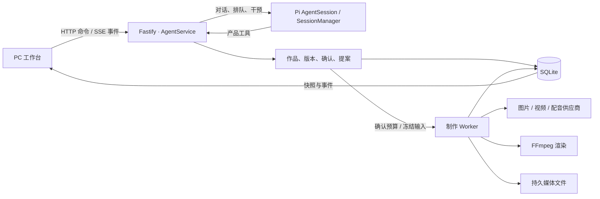

# Frame 架构设计

Frame 把一次对话和一次付费制作分开。Pi 决定怎样回答、是否调用可用的工具；Frame 保存作品事实，并决定一项操作是否得到了用户授权。

| 部件 | 责任 | 实现入口 |
| --- | --- | --- |
| PC 工作台与 HTTP 层 | 对话、预览、设置、命令与订阅；请求入口鉴权、来源和载荷检查 | [客户端](../../apps/studio/src/client/agent)、[路由](../../apps/studio/src/server/agent/routes.ts) |
| Pi Runtime | 模型对话、上下文、会话历史、工具执行与 Skill 发现；Frame 装配业务工具并持久化可见消息 | [Pi 适配](../../apps/studio/src/server/agent/pi-runtime.ts)、[业务工具](../../apps/studio/src/server/agent/pi-tools.ts) |
| 作品与执行授权 | 每件作品分别保存草稿修订、确认和来源。素材、版本、模型、操作和费用随受理冻结 | [创作状态](../../apps/studio/src/server/agent/creative-work.ts)、[制作服务](../../apps/studio/src/server/agent/production-service.ts) |
| 后台制作 | 供应商请求、异步轮询、输出登记、本地处理与费用事实；刷新页面不创建第二次制作 | [Worker](../../apps/studio/src/server/agent/production-worker.ts)、[本地渲染](../../apps/studio/src/server/agent/local-render.ts) |
| 数据 | SQLite 管作品、命令、提案、运行及事件；文件系统存 Pi 会话、Skill 包和媒体，需一起持久化 | [装配](../../apps/studio/src/server/agent/assembly.ts)、[数据迁移](../../apps/studio/src/server/agent/db.ts) |

**为什么一次认可不能包办整条流程。** 认可内容是对一个稿件版本的判断；确认预算才是对一次付费执行的许可。技术上，受理将提案与已确认输入、配置修订、执行范围和运行 ID 绑定。供应商网络调用在事务外进行。收到输出后发布视频草稿，用户另行认可才进作品库。

**恢复。** 工作台先读快照，再按游标订阅事件；断线后的重复事件不表示新动作。Pi 会话负责重建模型上下文，SQLite 负责回答“哪个版本已确认、工作是否已受理、费用有无终局”。供应商结果不明时保留已有尝试供核查，不把超时当作可免费重发的依据。

**设置与扩展。** 模型连接按用途投影，切换只影响后续执行。Skill 安装使用应用专属 Pi 包目录。素材、免费音乐、热歌榜和资讯由 Agent 工具访问；可自托管的服务使用配置地址。旧流水线的 broker 不参与 Frame 在线请求。

接口变更以 [契约索引](../../contracts/agent/v1/IMPORT.md) 为入口。
