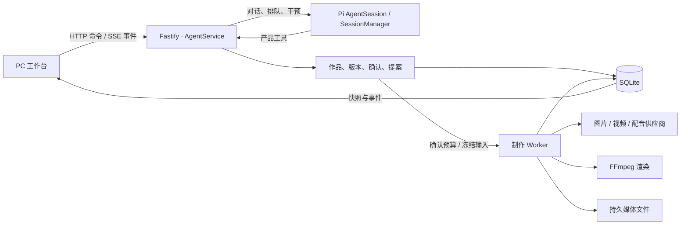
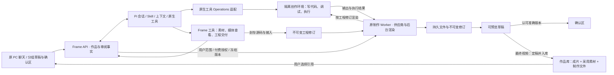

# Frame 架构设计

Frame 把一次对话和一次付费制作分开。Pi 决定怎样回答、是否调用可用的工具；Frame 保存作品事实，并决定一项操作是否得到了用户授权。

| 部件 | 责任 | 实现入口 |
| --- | --- | --- |
| PC 工作台与 HTTP 层 | 对话、预览、设置、命令与订阅；请求入口鉴权、来源和载荷检查 | [客户端](../../apps/studio/src/client/agent)、[路由](../../apps/studio/src/server/agent/routes.ts) |
| Pi Runtime | 模型对话、上下文、会话历史、工具执行与 Skill 发现；Frame 装配业务工具并持久化可见消息 | [Pi 适配](../../apps/studio/src/server/agent/pi-runtime.ts)、[业务工具](../../apps/studio/src/server/agent/pi-tools.ts) |
| 作品与执行授权 | 每件作品分别保存草稿修订、确认和来源。素材、版本、模型、操作和费用随受理冻结 | [创作状态](../../apps/studio/src/server/agent/creative-work.ts)、[制作服务](../../apps/studio/src/server/agent/production-service.ts) |
| 后台制作 | 供应商请求、异步轮询、输出登记、本地处理与费用事实；刷新页面不创建第二次制作 | [Worker](../../apps/studio/src/server/agent/production-worker.ts)、[本地渲染](../../apps/studio/src/server/agent/local-render.ts) |
| 数据 | SQLite 管作品、命令、提案、运行及事件；文件系统存 Pi 会话、Skill 包和媒体，需一起持久化 | [装配](../../apps/studio/src/server/agent/assembly.ts)、[数据迁移](../../apps/studio/src/server/agent/db.ts) |

**为什么一次认可不能包办整条流程。** 认可内容是对一个稿件版本的判断；确认预算才是对一次付费执行的许可。技术上，受理将提案与已确认输入、配置修订、执行范围和运行 ID 绑定。供应商网络调用在事务外进行。收到输出后发布视频草稿，用户另行认可才进作品库。

**恢复。** 工作台先读快照，再按游标订阅事件；断线后的重复事件不表示新动作。Pi 会话负责重建模型上下文，SQLite 负责回答“哪个版本已确认、工作是否已受理、费用有无终局”。供应商结果不明时保留已有尝试供核查，不把超时当作可免费重发的依据。

**设置与扩展。** 文本连接投影单个当前型号；图片、视频、配音将所有已启用且适配的条目投影为四字段 `ModelBinding`（`providerId`、`modelId`、`executionVersionId`、`configurationRevisionId`）模型池及可选默认值，改选默认仅影响新提案，提案内换型通过确定性 `rebind` 窄范围重算报价并刷新摘要，无需重新唤醒 Pi；Google Colab（`ColabLtxVideoPort`）与 Edge 免费配音（`EdgeSpeechPort`）共用同一套提案受理与 `ProductionWorker` 执行边界。Skill 安装使用应用专属 Pi 包目录。素材、免费音乐、热歌榜和资讯由 Agent 工具访问；可自托管的服务使用配置地址。旧流水线的 broker 不参与 Frame 在线请求。

接口变更以 [契约索引](../../contracts/agent/v1/IMPORT.md) 为入口。

## 已实施的能力扩展：分组审阅与工程化创作（2026-11-08 收口）

新创作路径以实际审阅组替代固定的内容/方案/视频状态机，组内项分别持有草稿、已认可版本和来源。认可与继续、局部预览与整片制作、生成完成与最终定稿分别记录；不引入通用工作流图引擎。

Pi 原生读、写、编辑和执行工具通过公共 Operations 接口接入隔离环境。Pi 默认拥有所在进程权限，工作目录不是沙盒；仅隔离 bash 也不能约束其他文件工具。因此所有生成代码 IO 共用执行边界，模型凭据、业务数据库、会话原件和宿主控制接口留在边界外。当前生产容器没有 Docker 控制能力；具体执行适配须先通过本地与生产同构小样，不通过增加 Web app 特权来掩盖部署缺口。

付费生成继续使用现有受理与费用事实；明确请求的免费本地渲染保存真实请求来源，不伪造提案、授权或财务记录。正式交付的代码图片、音频与短片统一先封存工程，再交既有 Worker 渲染，临时 bash 试验不构成第二条正式发布路径。后台完成直接发布草稿，不额外拉起 Pi；新稿不改变在途输入，旧结果也不覆盖已经产生的后继稿。

inputSources 记录制作使用的准确来源，reviewInputs 只记录本次必要的真实认可依据；内部工程文件不必逐个确认。Pi 回合中的确认工具只记事实，由当前回合处理用户剩余意图；按钮“认可并继续”才另外排一次请求。最终入库只接受明确的 finalize_video，不由一般认可推断。

媒体继续复用 blob 存储，工程文件在执行前保留源码、必要资源、入口、依赖和时间线。最终定稿只引用该次制作快照，不能采集当前最新稿或工作目录。作品库选材持久化到消息及其读取上下文，引用带准确版本和出处，派生编辑不修改原作。旧作品按真实历史来源迁移，缺失信息如实标为未记录。

本节描述的结构已随契约 0.1.33 与组审阅实现落地；发布契约以接口索引版本为准，前后端共同经同一份 Schema/OpenAPI 生成类型切换，无新旧状态双写。

## 准确产出与素材留存

独立文稿可直接认可，不为普通讨论创建视频作品；明确开始时可采用已交付的文稿。用户消息保留具体认可动作，Pi 读取原意并继续处理其余要求，不根据提示词推断定稿。

每个制作操作在发布事务内登记准确的 `output_revision_id`，媒体字节仍由原 blob 去重。再次交付或把预览采用为成片时，沿既有 `CreationBinding.adoptedFrom` 保留原制作来源，不用相同字节、当前最新稿或整个运行的候选反推素材。作品库和跨会话选材共用实际消费路径，保留所用生成片段与音轨；工程提供的输入标明“提供给工程”，不声称任意代码一定把它绘入了画面。

取帧供模型查看时使用受限尺寸的图像副本，原媒体文件不改。Pi 会话恢复仍由原生会话管理完成；Frame 在模型输入边界投影历史图像，不另建上下文或重试框架。代码执行失败保留实际阶段和有界输出尾部，便于在新工程修订中修正，冻结的旧工程不被重写。
